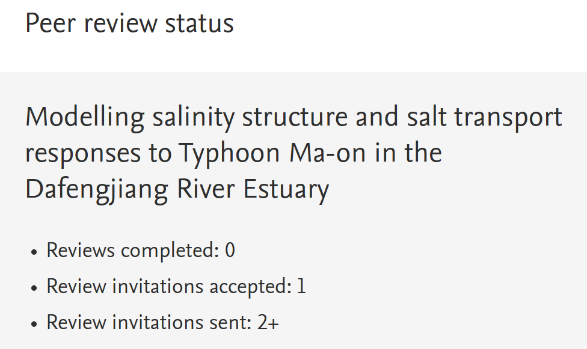
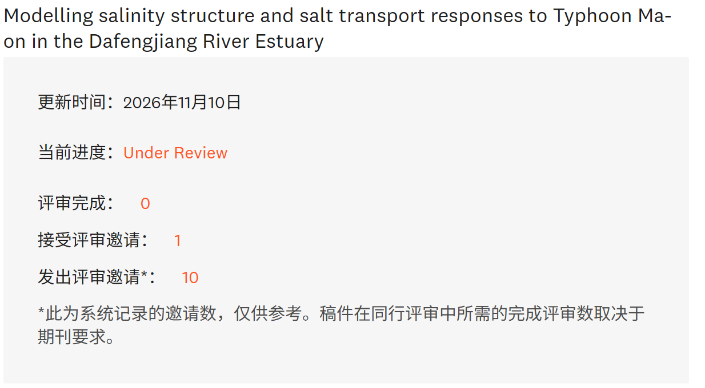
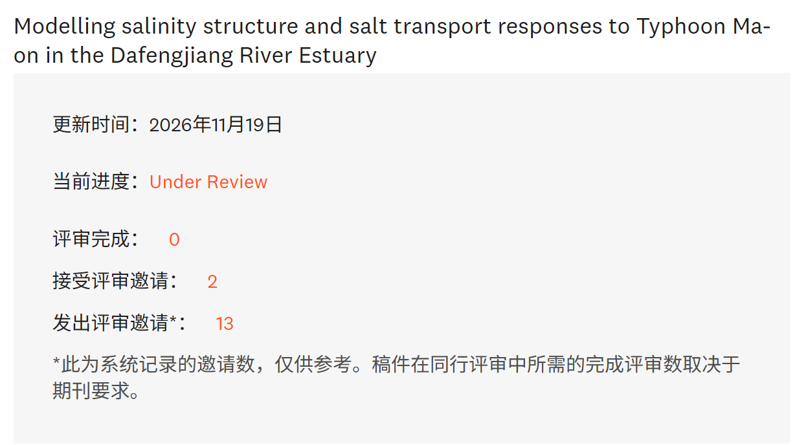
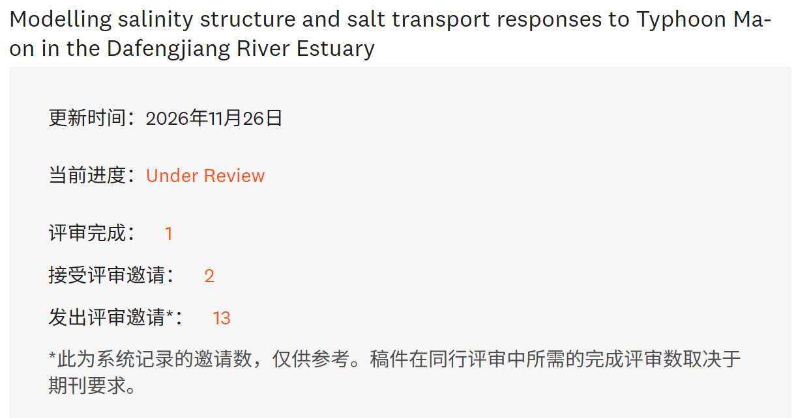

### 2026年10月22日

投稿，Status Date为`Oct 22, 2026`，Current Status为`With Editor`

------

### 2026年10月26日

Status Date变为`Oct 26, 2026`

------

### 2026年10月28日

Status Date变为`Oct 27, 2026`，Current Status变为`Under Review`

------

### 2026年10月29日

邀请`4`位审稿人，`1`位审稿人接受邀请

------

### 2026年11月7日

又邀请`6`位审稿人，共邀请`10`位审稿人，`1`位审稿人接受邀请

------

### 2026年11月18日

又邀请`3`位审稿人，共邀请`13`位审稿人，`2`位审稿人接受邀请

------

### 2026年11月26日

`2`位审稿人接受邀请，`1`位审稿人评审完成

------

